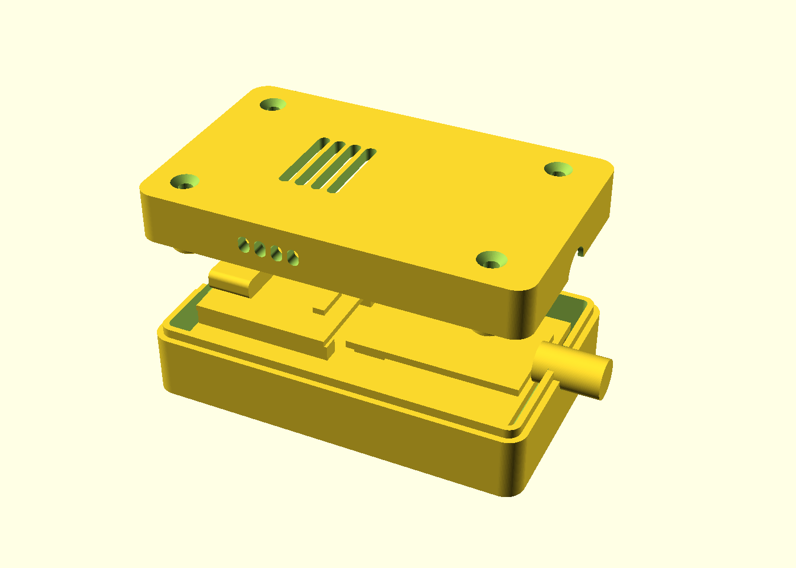

# Enclosure

A two-piece 3D-printed case for the eyocean-ha carrier board (`../pcb/`): an
ESP32-S3 SuperMini and a CC1101 433 MHz module, both soldered directly onto
the carrier. Everything is in one parametric OpenSCAD file,
[`enclosure.scad`](enclosure.scad), built on [BOSL2](https://github.com/BelfrySCAD/BOSL2).



- **Outside size:** 60.5 × 37 × 18.1 mm.
- **Base and lid:** they split on the CC1101's SMA axis. The base wall has a
  U-slot, so the assembled board drops in with the SMA thread already through
  the east wall; the lid closes over it.
- **Openings:** USB-C in the west wall, with a recess for the plug body. WiFi
  slots in the roof and side walls over the SuperMini's chip antenna.
- **Fastening:** four M2 × 16 flat-head bolts go in flush from the lid top,
  through the lid pillars, the board's corner holes and the base standoffs,
  into M2 hex nuts held in pockets under the base. The same bolts clamp the
  board.

## Prerequisites

- **OpenSCAD 2021.01 or newer.** Check with `openscad --version`.
- **BOSL2, a git submodule at `cad/BOSL2`.** Clone with `--recursive`, or
  inside an existing clone run:

  ```bash
  git submodule update --init
  ```

- **Optional:** `xvfb-run` for rendering PNG previews on a headless machine.

## Build

```bash
cad/export.sh
```

This writes the two printable parts in print orientation, sitting on z = 0:

| File | Part | On the bed |
| --- | --- | --- |
| `export/enclosure_bottom.stl` / `.3mf` | Base | floor down |
| `export/enclosure_lid.stl` / `.3mf` | Lid | roof down |

Any Customizer parameter can be overridden with `-D`, and the script passes
it to every export:

```bash
cad/export.sh -D cc_spacer_h=2.3 -D sma_hole_d=7.0
```

The script fails (non-zero exit, no file) if OpenSCAD reports an error. Fit
checks inside the model stop the export with a clear message, for example
when the bolt is too long or the pin tails don't fit (see
[Troubleshooting](#troubleshooting)).

Other ways to work with the model:

```bash
# Check only (parse + fit checks, no geometry) and print the computed sizes:
OPENSCADPATH=cad openscad -o /tmp/enclosure.echo cad/enclosure.scad && cat /tmp/enclosure.echo

# Exploded assembly preview PNG (needs a display, or xvfb-run):
OPENSCADPATH=cad xvfb-run -a openscad --render --viewall --autocenter \
  --imgsize=1400,1000 -o cad/enclosure.png cad/enclosure.scad

# Interactive: open in the OpenSCAD GUI; Window > Customizer lists every
# parameter below; set "part" to bottom / lid / print / assembly.
openscad cad/enclosure.scad
```

`export.sh` puts `cad/` on `OPENSCADPATH` for you. When you call `openscad`
by hand from the repo root, set `OPENSCADPATH=cad` so `include <BOSL2/std.scad>`
resolves.

## How the heights are calculated

All heights are measured from **z = 0 = the carrier board's bottom face**.
(Heights above the carrier's *top* surface are 1.6 mm less.) Each module
sits on its male header's plastic spacer, soldered straight onto the
carrier with no socket:

```text
 12.6 ── case top ───────────────────────────── z_top = roof_bot + roof_t
 10.6 ── roof underside ──────────────────────── roof_bot = parts_top + top_clear
  9.1 ── tallest part (CC1101 top) ──────────── parts_top
  6.73 ─ USB-C centre                            usb_z
  4.7 ── SMA axis = base/lid split               sma_z = cc_z + sma_axis_h
  4.1 ── module boards (bottom face) ─────────── sm_z / cc_z
         2.5  male-header plastic spacer         sm_spacer_h / cc_spacer_h
  1.6 ── carrier top
         1.6  carrier PCB                        pcb_t
  0.0 ── carrier bottom
         3.5  standoffs, room for pin tails      standoff_h
 -3.5 ── floor top
         2.0  floor                              floor_t
 -5.5 ── case bottom ─────────────────────────── z_bot
```

| Value | Formula | Default |
| --- | --- | --- |
| SuperMini board bottom `sm_z` | `pcb_t + socket_h + sm_spacer_h` | 1.6 + 0 + 2.5 = **4.1** |
| CC1101 board bottom `cc_z` | `pcb_t + socket_h + cc_spacer_h` | 1.6 + 0 + 2.5 = **4.1** |
| USB-C centre `usb_z` | `sm_z + sm_t + usb_shell.y / 2` | 4.1 + 1.0 + 1.63 = **6.73** |
| SMA axis = case split `sma_z` | `cc_z + sma_axis_h` | 4.1 + 0.6 = **4.7** |
| Tallest part `parts_top` | max(`sm_z + sm_t + usb_shell.y`, `cc_z + cc_h`) | max(8.36, 9.1) = **9.1** |
| Roof underside `roof_bot` | `parts_top + top_clear` | **10.6** |
| Case top `z_top` | `roof_bot + roof_t` | **12.6** |
| Case bottom `z_bot` | `-(standoff_h + floor_t)` | **-5.5** |
| Overall height | `z_top - z_bot` | **18.1** |

**Why the two modules have separate spacers.** The CC1101 arrives with its
header already fitted (the spacer isn't given in `../CC1101_specs/`), while
you fit the SuperMini's header yourself. Setting each on its own moves only
the openings that depend on it:
- `sm_spacer_h` moves the USB-C hole.
- `cc_spacer_h` moves the SMA hole and the split line.
- Either one moves the roof if it makes that module the tallest part.

**Socketed build.** If you ever plug the modules into female sockets
instead, set `socket_h` to the socket body height (8.5 standard, 5.0
low-profile); everything moves up by that much.

**Bolts.** The nut sits at the top of its hex pocket, and the bolt tip ends
0.3 mm past it. The pocket depth is automatic (`nut_pocket = 0`): it is
deep enough to put a `bolt_len` head exactly flush, kept between
`nut_h + 0.6` and 1.2 mm short of the board. With the defaults it works out
to 4.0 mm:

- `tip_z = z_bot + nut_pocket - nut_h - 0.3` = -5.5 + 4.0 - 1.6 - 0.3 = -3.4
- `head_z = tip_z + bolt_len` = -3.4 + 16 = **12.6** = `z_top`, so an M2 × 16
  flat head is exactly flush.

If your measured spacers change the case height a little, the pocket
follows, so the M2 × 16 stays flush. With M2 × 14 or M2 × 12 the pocket
maxes out and the head sinks about 2 or 4 mm into a counterbore in a
thickened lid pillar. A bolt that would stick out is refused, and the
message gives the longest that fits. Set `nut_pocket` to a number to force
a fixed depth.

**Board length.** The carrier is 53.5 mm long and ends exactly at the
CC1101's east edge. The SMA barrel (Ø6.3) is centred 4.7 mm up, so its
bottom is at 1.55 mm, just below the carrier top (1.6 mm). Ending the board
at the module edge lets the barrel hang past it.

### Opening tolerances

The openings are tight in z, so get the stack-up right:

| Opening | Hole | Part | Vertical slack |
| --- | --- | --- | --- |
| USB-C | 9.4 × 3.7 mm | 8.94 × 3.26 mm shell | ±0.22 mm |
| USB-C plug recess | 13.0 × 7.5 mm | ~12 × 6.5 mm plug body | ±0.5 mm |
| SMA | Ø6.5 mm (`sma_hole_d`) | Ø6.3 mm thread | ±0.1 mm |

## Measure your parts first

The defaults are typical values, not measurements of your parts. Before
printing, measure these with calipers and override what differs:

| Measure | How | Parameter (default) |
| --- | --- | --- |
| SuperMini height above the carrier top | Push the header fully home; carrier top → SuperMini board bottom | `sm_spacer_h` (2.5) |
| CC1101 height above the carrier top | Same, for the CC1101's pre-fitted header (drawing dim K) | `cc_spacer_h` (2.5) |
| SMA axis above the CC1101 board bottom | Board bottom → centre of the SMA thread; negative if the axis is below the board | `sma_axis_h` (0.6) |
| CC1101 tallest part | Board bottom → top of the tallest part (drawing dim D) | `cc_h` (5.0) |
| SMA body before the thread | Module edge → first thread | `sma_body` (2.5) |
| SuperMini board thickness | Calipers | `sm_t` (1.0) |
| USB-C shell height | Calipers | `usb_shell` ([8.94, 3.26]) |
| USB-C shell overhang | SuperMini edge → shell face | `usb_overhang` (0.3) |
| Pin tails under the carrier after trimming | Carrier bottom → longest pin tip | `pin_tail` (2.5) |

If the SMA rubs, open the hole with `-D sma_hole_d=7.0`. If the USB-C
plug catches top or bottom, try `-D 'usb_hole=[9.4, 4.0]'`.

## Print

- **Material:** PETG is the default (tough, fine near a warm desk lamp).
  PLA also works indoors.
- **Settings:** 0.2 mm layer height (the model is tuned for it), 3 walls,
  20 % grid infill, 4 top / 4 bottom layers.
- **Supports:** none. The base prints floor-down and the lid roof-down. The
  countersinks and nut pockets open onto the bed, so they print without
  bridging.
- **3MF vs STL:** prefer the 3MF files. They keep units, so slicers don't
  rescale them.

## Hardware

| Qty | Part |
| --- | --- |
| 4 | M2 × 16 flat-head (countersunk) bolt, DIN 965 / ISO 10642 |
| 4 | M2 hex nut (4.0 mm across flats, 1.6 mm thick) |
| 1 | 433 MHz antenna, SMA male |

The board itself (carrier PCB, both modules, 10 µF capacitor) is listed in
the [top-level README](../README.md#carrier-board--enclosure-esp32-s3-supermini).

## Assembly

1. **Solder the carrier.** Fit the 10 µF capacitor. Put the SuperMini (USB-C
   at the board's short edge) and the CC1101 (SMA pointing away from the
   SuperMini) on their pads, with each header's plastic spacer flat on the
   carrier. Push the CC1101 fully toward the board's SMA end so its edge
   lines up with the board edge. Solder from below.
2. **Trim the pin tails** under the carrier to ≤ 2.5 mm with flush
   cutters. The base only has 3.5 mm of room under the board.
3. **Drop the board into the base.** The holes land on the four standoffs,
   the SMA thread goes into the U-slot and out through the east wall, and
   the USB-C lines up with the west opening.
4. **Close the lid.** Its tongue-and-groove rim locates on the base, and its
   pillars press on the board's corners.
5. **Fit the nuts.** Push an M2 hex nut into each hex pocket under the base;
   it can't spin.
6. **Fit the bolts.** Push the four M2 × 16 bolts in from the lid top and
   tighten until the heads sit flush. Don't over-tighten: the pillars clamp
   the PCB.
7. **Screw the 433 MHz antenna** onto the SMA thread outside the case.

## Troubleshooting

| Symptom / message | Cause → fix |
| --- | --- |
| USB-C plug won't seat fully | Opening too high or low → measure `sm_spacer_h` / `sm_t`; or enlarge `usb_hole` |
| SMA thread rubs the hole or won't drop into the U-slot | SMA axis off → measure `cc_spacer_h` / `sma_axis_h`; or `sma_hole_d=7.0` |
| `bolt_len N too long: max M` | The bolt would stick out of the lid → use the max length shown, or a shorter bolt (counterbore) |
| `bolt_len N too short to reach the nut` | The bolt can't reach through → use a longer bolt |
| `standoff_h too low for N mm pin tails: trim them` | Trim the tails, or raise `standoff_h` (adds height) |
| `SMA barrel hits the carrier board` | `board_w` extends past the CC1101 edge at this height → shorten `board_w`, or raise `cc_spacer_h` |
| `standoff_d too thin around the nut pocket` | Keep `standoff_d` ≥ about 6.2 for `nut_af` 4.1 |
| `less than 3 mm of SMA thread outside the wall` | `sma_body` too long for this wall → check the measurement or thin `wall` |
| `include <BOSL2/std.scad>` not found | Run `git submodule update --init`; set `OPENSCADPATH=cad` when calling `openscad` directly |
